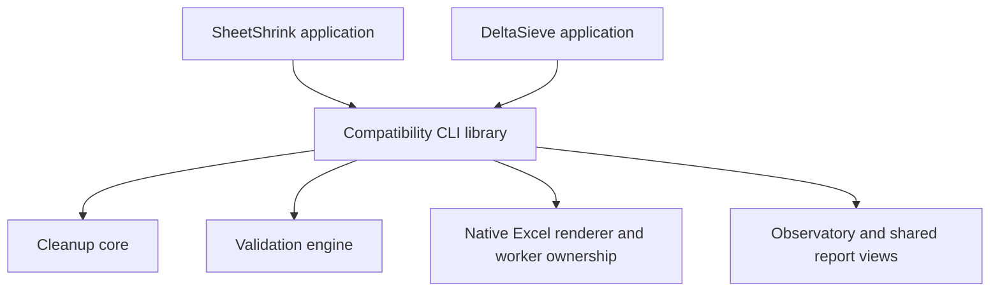

# Toolset component boundaries

The workspace is being separated incrementally while the pinned Enron runner
continues using its existing executable and runtime assets.

## Current ownership

| Component | Responsibility |
| --- | --- |
| `excel-shrink-core` | Deterministic workbook cleanup and sheet/chunk processing |
| `crates/deltasieve-engine` | Reusable validation evidence contracts, initially selected OOXML content fingerprints and reuse decisions |
| `excel-shrink-cli` library | Compatibility CLI, native rendering orchestration, acquisition, preparation, reporting and Observatory transport |
| `apps/sheetshrink` | SheetShrink executable and application entry point |
| `excel-shrink-cli` DeltaSieve binary | Independent validation application entry point and defaults |
| Shared `office-capture/control-room` assets | Live process presentation, result exploration and static replay components |

The extracted engine has no dependency on the cleanup core, Windows, Excel or
the Observatory. Its first public module, `reuse`, hashes selected uncompressed
OOXML members and checks both comparison partners against an earlier
observation. ZIP order and compression do not define content identity. A reuse
decision remains conditional on the caller's method and environment checks.

Version-one fingerprint fields and serialization remain compatible. The
extraction preserves the original decision implementation, with public API
visibility and documentation changes. Existing tests moved with the module;
an external integration test verifies the public API against a frozen JSON
contract containing independent SHA-256 expectations.

Extraction acceptance on 2026-11-08 passed all four reuse tests before and after
the move, the public JSON-contract test, two processing-cache integrity tests,
the compatibility executable service test and both SheetShrink entry-point
tests. `cargo check --workspace` passed. A normalized source comparison confirmed
the moved implementation differs only in API visibility and added Rustdoc.
No native Excel test or production executable replacement was needed for this
mechanical extraction.

## Remaining extraction

Native comparison orchestration and the Observatory still reside in the
compatibility CLI library. Subsequent changes must move coherent responsibilities
with their tests and update every normal start path. Keep producer execution,
renderer environment, result identities and persisted schemas explicit through
those moves. The present engine crate does not yet expose a complete standalone
rendering API. The DeltaSieve application already supplies standalone comparison
through the shared existing implementation.

Keep behavioral changes separate from component moves. Preserve the pinned
production executable and assets during extraction. A later evaluation release
requires ordinary start/resume, portable preparation import, report export and
cross-machine merge acceptance against its frozen binaries.
