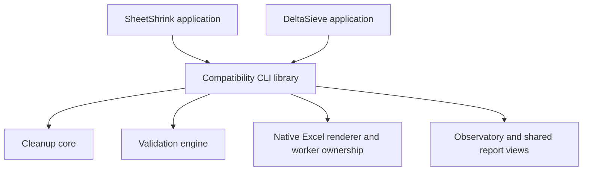

# Toolset component boundaries

The workspace is being separated incrementally while the pinned Enron runner
continues using its existing executable and runtime assets.

## Current ownership

| Component | Responsibility |
| --- | --- |
| `excel-shrink-core` | Deterministic workbook cleanup and sheet/chunk processing |
| `crates/deltasieve-engine` | Reusable validation evidence contracts, initially selected OOXML content fingerprints and reuse decisions |
| `excel-shrink-cli` library | Compatibility CLI, native rendering orchestration, acquisition, preparation, reporting and Observatory transport |
| `apps/sheetshrink` | SheetShrink executable and application entry point |
| `excel-shrink-cli` DeltaSieve binary | Independent validation application entry point and defaults |
| Shared `office-capture/control-room` assets | Live process presentation, result exploration and static replay components |

The extracted engine has no dependency on the cleanup core, Windows, Excel or
the Observatory. Its first public module, `reuse`, hashes selected uncompressed
OOXML members and checks both comparison partners against an earlier
observation. ZIP order and compression do not define content identity. A reuse
decision remains conditional on the caller's method and environment checks.

Version-one fingerprint fields and serialization remain compatible. The
extraction preserves the original decision implementation, with public API
visibility and documentation changes. Existing tests moved with the module;
an external integration test verifies the public API against a frozen JSON
contract containing independent SHA-256 expectations.

Extraction acceptance on 2026-11-08 passed all four reuse tests before and after
the move, the public JSON-contract test, two processing-cache integrity tests,
the compatibility executable service test and both SheetShrink entry-point
tests. `cargo check --workspace` passed. A normalized source comparison confirmed
the moved implementation differs only in API visibility and added Rustdoc.
No native Excel test or production executable replacement was needed for this
mechanical extraction.

## Remaining extraction

Native comparison orchestration and the Observatory still reside in the
compatibility CLI library. Subsequent changes must move coherent responsibilities
with their tests and update every normal start path. Keep producer execution,
renderer environment, result identities and persisted schemas explicit through
those moves. The present engine crate does not yet expose a complete standalone
rendering API. The DeltaSieve application already supplies standalone comparison
through the shared existing implementation.

Keep behavioral changes separate from component moves. Preserve the pinned
production executable and assets during extraction. A later evaluation release
requires ordinary start/resume, portable preparation import, report export and
cross-machine merge acceptance against its frozen binaries.

## Standalone Excel Rebuild

`apps/excel-rebuild` uses the shared Excel automation pool and preparation web
interface. CLI inputs accept files or folders, with `--recursive`, `--workers`,
`--reserve-mib` and an independent new `--output` directory. `--open-browser`
opens the configuration page without starting the workload automatically.

Each input is hash-verified into a separate source copy. Excel opens it read-only
with link updates disabled, macros forced off, events disabled and manual
calculation. `CalculateFullRebuild()` rebuilds formula dependencies and calculates
all formulas. Saving waits until `CalculationState` is done. The output is a
separate XLSX copy. The original bytes are checked again before publishing the
receipt. Worker sessions are reused and shared RAM/commit guards remain active.
Rebuild phases have a 900-second minimum stall allowance. Errors retain their
per-input diagnostics and do not publish successful prepared receipts.

Receipts identify the `excel-rebuild` operation, full-rebuild request, source and
output hashes, producer hash, native phase timings and package sizes. Outputs use
`input-NNNNNN/converted.xlsx` and a `sources.json` index. Source files remain
available alongside the output. Calculation uses each machine's Excel environment
and cached external links. Volatile functions and unavailable external references
can change calculated values and require separate attribution. This operation
alone establishes neither cell-value preservation nor visual equivalence.

### Saved cell-content audit

`deltasieve regression cell-audit --left LEFT.xlsx --right RIGHT.xlsx --output NEW_DIRECTORY`
compares saved values and formulas through the existing borrowed-byte comparator.
For a batch, `--manifest` accepts an array of `{label,left,right}` objects.
Worksheet names, order and relationship targets must agree. Both raw input hashes
are verified again after the comparison. Empty layout-only cells are ignored by
the existing strict missing-cell policy. Any parser or input-integrity failure
produces an explicit failed pair and a failing process exit after the batch.

Per-pair evidence retains all differences. Formula diagnostics sample at most32
records and retain unsupported or budget-limited cases. Dependency paths are
explanations and do not suppress differences or establish exclusive causation.
The compact progress record is replaced per pair; the full summary is written
once at the end. The audit neither starts Excel nor establishes visual equality.

The dedicated saved-content audit excludes column-width range validation.
Native Excel can save a width such as273.5703125 that exceeds the capture
planner's255 limit. This layout attribute does not change a cell's saved value
or formula. Capture and preservation callers retain their existing width
validation. Content-audit summaries use a separate cache namespace, so accepting
such an input cannot bypass a later caller's required layout validation.
